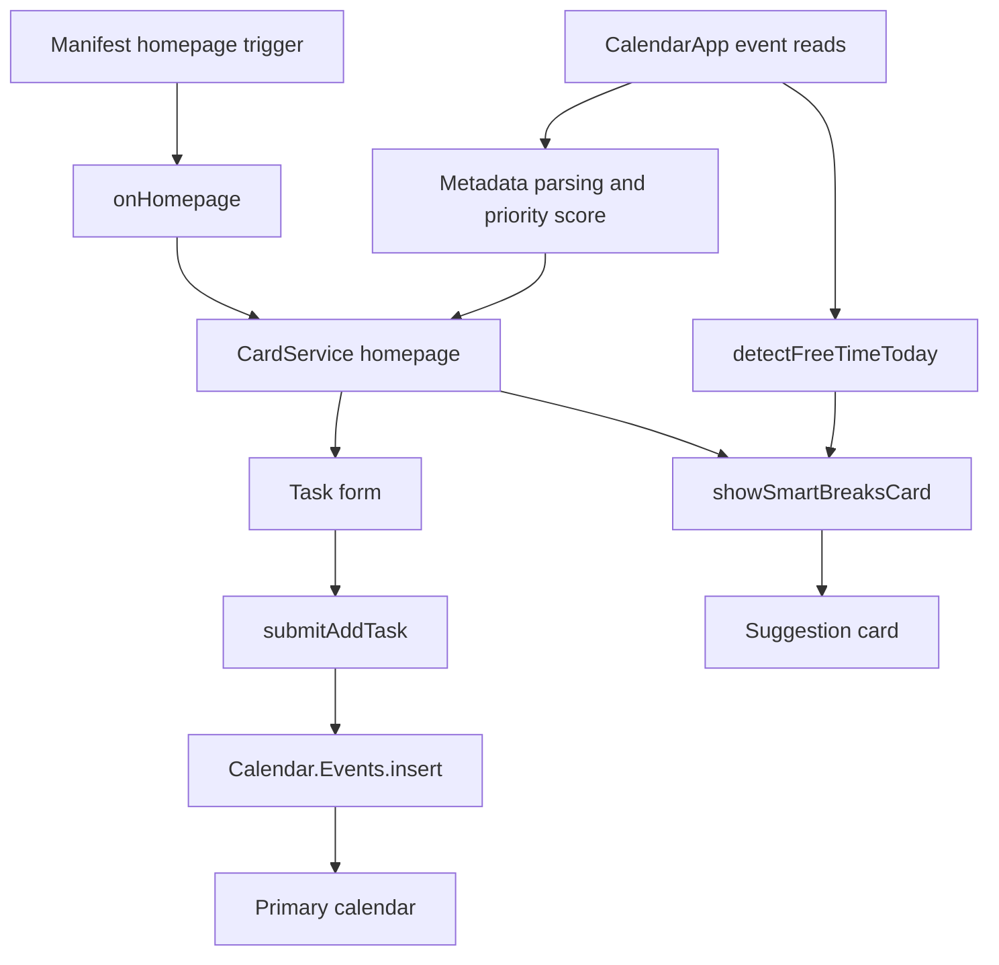

# Technical overview

[Project overview](README.md) · [Core UI and task logic](Code.gs) · [Break logic](smartbreaker.gs)

Smart Calendar Assistant runs inside Google Calendar as a Google Workspace add-on. Google Apps Script hosts the JavaScript, CardService supplies the sidebar UI, and Calendar services read and create events. There is no separate application server or database in this repository.

## Architecture



The manifest configures the V8 runtime, `America/Chicago`, the Calendar v3 advanced service, and `onHomepage` as the Calendar homepage trigger. It declares Calendar access, add-on execution, and container-UI scopes. Task writes use `Calendar.Events.insert(..., "primary")`; reads use `CalendarApp.getDefaultCalendar()`. Daily boundaries and display formatting explicitly use that calendar's `getTimeZone()`, independent of the script time zone.

## Task creation and organization

`showAddTaskForm()` builds fields for title, start time, duration, tag, priority, flexibility, and color. The form offers ten tags, three priority levels, two flexibility choices, and ten event colors.

`submitAddTask()` calls `buildTaskEvent_()` to validate the form before inserting a Calendar event. Tag, priority, and flexibility are serialized into the description as labeled text; the selected color uses the Calendar event's `colorId`. The response displays a confirmation card and notification.

### Date-time contract

The date-time picker supplies `dateTimeInput.msSinceEpoch` as a scalar string representing an absolute instant. The implementation reads the complete value; a one-element array is also accepted for compatibility. It rejects missing/partial dates, malformed epochs, invalid dates, nonpositive or nonfinite durations, and invalid dropdown values before any Calendar write.

The former reader could index a scalar string at `[0]`, reducing the timestamp to its first digit. It also added the runtime timezone offset to an already absolute timestamp. Both behaviors are removed. Start/end values now use `toISOString()` with an explicit UTC offset (`Z`). Duration is elapsed hours, so a one-hour task remains one hour across a daylight-saving transition even if the displayed wall-clock hour jumps or repeats.

The picker keeps Google's default user-time-zone display; no fixed offset is forced into it. Confirmation uses `Utilities.formatDate` with the primary calendar's IANA time zone, includes the date and zone, and may therefore differ from the picker's displayed zone when the user and calendar settings differ.

### Metadata contract

Parsing is anchored to individual labeled lines. LF, CRLF, CR, `<br>` breaks, and basic HTML wrappers are supported. Tags can contain spaces and Unicode without swallowing the next line. Priority and flexibility must match complete allowed values and are normalized to canonical capitalization. The first valid occurrence of each key wins; unrecognized lines and invalid values are ignored so the caller's defaults still apply. New descriptions keep tag values on one line. User-controlled title/tag text is escaped when displayed in CardService paragraphs.

**Design trade-off:** using the calendar as storage keeps the prototype small and makes created tasks visible in the normal Calendar UI. Description-based metadata is easy to inspect, but editing or reformatting the description can break parsing. A more durable implementation could use structured event metadata instead of editable description text.

## Today's Focus

The homepage reads events from now through the next seven days, retains events whose start date is today in the primary calendar's time zone, sorts by descending score, and shows at most three. This is not a complete history of today's events: past events outside the read window are not included.

The score is deterministic:

```text
score = round(tagWeight × 20 × deadlineFactor × priorityFactor × flexibilityFactor)

tagWeight:         3 for every event in the current caller
deadlineFactor:    clamp(7 / (daysUntilEventEnd + 1), 0.5, 2)
priorityFactor:    High 1.5 | Medium 1.0 | Low 0.8
flexibilityFactor: No 1.2 | Yes 0.8
```

Event end time acts as the deadline proxy. Although the function accepts a tag weight, the current caller passes the same value for every event, so tags do not currently personalize ranking. The flexibility flag affects the score; it does not reschedule an event. There is no learned ranking model or automatic calendar optimizer.

## Break-suggestion algorithm

The single `showSmartBreaksCard(e)` calls `detectFreeTimeToday()`:

1. Obtain today's date using `Utilities.formatDate` in the primary calendar's time zone, then parse its **23:00** boundary with `Utilities.parseDate` in the same zone. Return an empty list at or after the boundary without querying Calendar.
2. Read overlapping events, clip them to the window, and sort by start time.
3. Start a cursor at now. Before each event, emit a gap only if it is at least **25 minutes** long.
4. Move the cursor forward to the later of its current position and the event's end. This handles overlapping and nested busy intervals.
5. Include a sufficiently long trailing gap before 23:00.
6. Map each gap length to a fixed activity suggestion.

| Free interval | Recommendation category |
| --- | --- |
| 25–39 minutes | Stretch, hydrate, and rest eyes |
| 40–69 minutes | Walk, light exercise, or a snack |
| 70+ minutes | Longer rest or an enjoyable activity |

Labels use the same calendar time zone and include its zone abbreviation. All-day events remain occupied intervals, preserving the previous active flow's conservative behavior. The displayed time range represents the entire free interval, not a separately optimized break duration. The algorithm sorts in O(n log n) time and scans in O(n) time. It is an explicit scheduling heuristic, with no external AI request.

### One entry point

The duplicate `showSmartBreaksCard` declaration and the unused 15-minute-gap/Add-button implementation have been removed, along with their obsolete date formatter. There is one informational card and one interval scan. The existing 25-minute minimum and 40/70-minute activity boundaries are retained. The break card does not write events.

## Verification and current boundaries

**October 30, 2026: 17 local regression tests passed.** Run:

```sh
npm test
```

Node.js 18+ is sufficient; no third-party test packages or Google credentials are needed. The tests load the actual `.gs` files into an isolated VM and mock Calendar reads/writes, CardService builders, and Utilities date functions. The Utilities mock uses Node's IANA time-zone data; expected UTC boundaries for DST and fractional-offset cases are fixed independently in the tests.

| Area | Checked behavior |
| --- | --- |
| Timestamp ingestion | Full scalar epoch string, numeric/one-element-array inputs, epoch zero, malformed and partial date rejection |
| Task creation | Exact UTC start/end passed to the mocked API; invalid forms produce no writes; fractional positive durations work |
| Time zones | Calendar/script-zone mismatch, UTC/local date crossover, spring/fall DST transitions, and a 45-minute-offset zone |
| Metadata | Line boundaries, Unicode, case normalization, HTML breaks, invalid values, duplicate-field policy, and generated-description round trips |
| Display | Escaped user text, calendar-zone labels, and rule-based wording |
| Free intervals | Overlap/nesting, cross-midnight clipping, all-day occupancy, minimum length, activity thresholds, and the after-23:00 guard |
| Consolidation | A single break entry point builds an informational card without Calendar writes |

These tests validate local application logic and the service calls it constructs. They do not execute Google's real Utilities/CardService implementations or prove a live authorization/deployment works. No real Calendar events were created by this verification.

### Manual installation checks

Before relying on an Apps Script test installation:

1. Choose a known date/time in the picker, submit a sample task, and compare the saved Calendar event with the confirmation. Repeat with user and primary-calendar time zones set differently.
2. Test a future date across a DST transition and confirm the saved start instant and elapsed duration.
3. Edit a task's description to contain multiple metadata lines; confirm its tag, priority, and flexibility are read independently.
4. Check overlapping events and a fully occupied day; after 23:00 the break card should report no remaining interval.

### Remaining boundaries

The availability window is fixed at 23:00 and all-day entries occupy their intervals; working-hours configuration and free/busy transparency preferences are not implemented. Description metadata can still be removed by manual edits. Duplicate-submission prevention and a complete API failure/retry experience remain future work. The date-time picker and live Google service behavior require the manual checks above.

The maintenance changes improve the team's prototype. They do not establish a Marketplace release, user adoption, or a measured productivity gain.

## Team contribution boundary

This is the work of a seven-member ACM@UIUC SIGCHI team. Zichen (Joe) Zhu's role as group leader focused on **feature design, task allocation, and feature demonstrations**. Technical descriptions explain the team's code, rather than assigning every implementation detail to the group leader.

## Platform references

- [Google: Date-time picker event values](https://developers.google.com/workspace/add-ons/concepts/event-objects#date-time_picker_form_inputs)
- [Google: DateTimePicker](https://developers.google.com/apps-script/reference/card-service/date-time-picker)
- [Google: Utilities date formatting and parsing](https://developers.google.com/apps-script/reference/utilities/utilities)
- [Google: Advanced Calendar service](https://developers.google.com/apps-script/advanced/calendar)
- [Google: Test and debug unpublished Workspace add-ons](https://developers.google.com/workspace/add-ons/how-tos/testing-workspace-addons)
