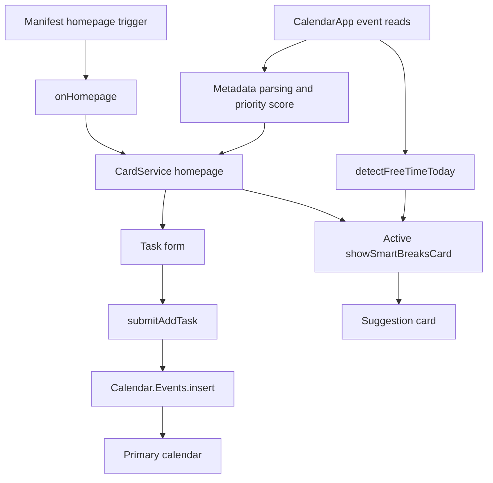

# Technical overview

[Project overview](README.md) · [Core UI and task logic](Code.gs) · [Break logic](smartbreaker.gs)

Smart Calendar Assistant runs inside Google Calendar as a Google Workspace add-on. Google Apps Script hosts the JavaScript, CardService supplies the sidebar UI, and Calendar services read and create events. There is no separate application server or database in this repository.

## Architecture



The manifest configures the V8 runtime, `America/Chicago`, the Calendar v3 advanced service, and `onHomepage` as the Calendar homepage trigger. It declares Calendar access, add-on execution, and container-UI scopes. Task writes use `Calendar.Events.insert(..., "primary")`; reads use `CalendarApp.getDefaultCalendar()`.

## Task creation and organization

`showAddTaskForm()` builds fields for title, start time, duration, tag, priority, flexibility, and color. The form offers ten tags, three priority levels, two flexibility choices, and ten event colors.

`submitAddTask()` reads the Apps Script form event, computes an end time, and inserts a Calendar event. Tag, priority, and flexibility are serialized into the description as labeled text; the selected color uses the Calendar event's `colorId`. The response displays a confirmation card and notification.

**Design trade-off:** using the calendar as storage keeps the prototype small and makes created tasks visible in the normal Calendar UI. Description-based metadata is easy to inspect, but editing or reformatting the description can break parsing. A more durable implementation could use structured event metadata and stricter validation.

## Today's Focus

The homepage reads events from now through the next seven days, retains events whose start date is today, sorts by descending score, and shows at most three. This is not a complete history of today's events: past events outside the read window are not included.

The score is deterministic:

```text
score = round(tagWeight × 20 × deadlineFactor × priorityFactor × flexibilityFactor)

tagWeight:         3 for every event in the current caller
deadlineFactor:    clamp(7 / (daysUntilEventEnd + 1), 0.5, 2)
priorityFactor:    High 1.5 | Medium 1.0 | Low 0.8
flexibilityFactor: No 1.2 | Yes 0.8
```

Event end time acts as the deadline proxy. Although the function accepts a tag weight, the current caller passes the same value for every event, so tags do not currently personalize ranking. The flexibility flag affects the score; it does not reschedule an event. There is no learned ranking model or automatic calendar optimizer.

## Active break-suggestion algorithm

The active `showSmartBreaksCard(e)` calls `detectFreeTimeToday()`:

1. Set the window to **now → 23:00 today**.
2. Read events overlapping the window and sort by start time.
3. Start a cursor at now. Before each event, emit a gap only if it is at least **25 minutes** long.
4. Move the cursor forward to the later of its current position and the event's end. This handles overlapping and nested busy intervals.
5. Include a sufficiently long trailing gap before 23:00.
6. Map each gap length to a fixed activity suggestion.

| Free interval | Recommendation category |
| --- | --- |
| 25–39 minutes | Stretch, hydrate, and rest eyes |
| 40–69 minutes | Walk, light exercise, or a snack |
| 70+ minutes | Longer rest or an enjoyable activity |

The displayed time range represents the entire free interval, not a separately optimized break duration. The algorithm sorts in O(n log n) time and scans in O(n) time. It is an explicit scheduling heuristic, with no external AI request.

### Retained older implementation

`smartbreaker.gs` declares `showSmartBreaksCard` twice. The later declaration is the active one under JavaScript function-declaration behavior, which was also checked in a local execution of the unmodified file.

The earlier version uses `findGaps_()` with a 15-minute threshold, offers different activity categories, and includes an Add button linked to `addBreakToCalendar_()`. These helpers remain in the file, but the later active card displays text suggestions without that Add button. The current showcase therefore does not describe one-click break insertion as an active UI feature.

## Verification and current boundaries

The documentation review on **October 30, 2026** inspected all three source/configuration files and executed the JavaScript in an isolated local context with a fixed clock and mocked Calendar reads. A constructed schedule confirmed that the active detector handled nested busy events, omitted a 20-minute gap, and returned 30-minute, 60-minute, and trailing free intervals with the corresponding rule categories. A scoring example produced High > Medium > Low for otherwise identical tasks.

These are local behavior checks, not a live Google Calendar authorization, event-write test, or production reliability assessment. The source files were not changed as part of this documentation update.

Known boundaries of the archived prototype:

- **Metadata parsing:** the tag regex allows newlines. A description containing `Tag: Study` followed by `Priority: High` can parse the tag as `Study\nPriority`. Priority and flexibility still parse separately in that example.
- **Date/time handling:** the task path manually adjusts a timestamp by a timezone offset; break labels use locale formatting, and a retained date formatter does not pad the day. Cross-time-zone and daylight-saving correctness is not established.
- **Availability window:** the active detector does not explicitly remove all-day events, and its fixed 23:00 boundary needs an after-hours guard. It is not a configurable working-hours planner.
- **Input and write handling:** positive duration validation, duplicate-submission prevention, and a complete error/retry experience are not implemented.
- **Version clarity:** the duplicate entry point should be consolidated before further feature work so displayed functionality is unambiguous.

These limitations are documented to distinguish the implemented prototype from potential next steps. No user-count, productivity-gain, or Marketplace-release claim is made.

## Team contribution boundary

This is the work of a seven-member ACM@UIUC SIGCHI team. Zichen (Joe) Zhu's role as group leader focused on **feature design, task allocation, and feature demonstrations**. Technical descriptions explain the team's code, rather than assigning every implementation detail to the group leader.

## Platform references

- [Google: Advanced Calendar service](https://developers.google.com/apps-script/advanced/calendar)
- [Google: Test and debug unpublished Workspace add-ons](https://developers.google.com/workspace/add-ons/how-tos/testing-workspace-addons)
