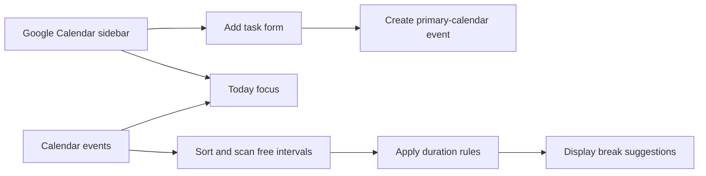

# Smart Calendar Assistant

**Organize tasks, surface today's priorities, and find time for a break inside Google Calendar.**

An **ACM@UIUC SIGCHI team project**, developed by a seven-member team led by **Zichen (Joe) Zhu**. Built as a Google Workspace add-on with JavaScript and Google Apps Script.

[Features](#what-it-does) · [Technical overview](ENGINEERING.md) · [My role as team lead](#my-role-as-team-lead) · [Try the prototype](#try-the-prototype)

## What it does

| Feature | User experience | Implementation |
| --- | --- | --- |
| Task creation | Add a title, start time, and duration directly from the sidebar | CardService form → Calendar API event insertion |
| Task organization | Set a tag, priority, flexibility flag, and event color | Metadata in the event description; native Calendar color IDs |
| Today's Focus | See up to three of today's retrieved events, ranked by a priority score | Rule-based score using priority, flexibility, and event end time |
| Smart Break Suggestions | View free intervals remaining today with a suggested break activity | Sorted-event scan, minimum-gap threshold, and duration-based rules |

**Smart Break Suggestions is rule-based.** It does not call an AI model or an external recommendation API. The current break card displays suggestions; it does not automatically change the calendar.

## A typical workflow

1. Open the add-on sidebar and review **Today's Focus**.
2. Choose **Add Task**, enter the event details, and select its organizational attributes.
3. Submit the form to create a colored event on the primary calendar.
4. Open **Smart Break Suggestions** to see free intervals from now until 23:00 and activity ideas appropriate to their length.

## My role as team lead

**I led a seven-member ACM@UIUC SIGCHI team, focusing on feature design, task allocation, and feature demonstrations.**

- **Feature design:** defined the add-on's task-organization and break-suggestion functionality and how users would interact with it inside Calendar.
- **Task allocation:** divided project work among team members and assigned responsibility for features.
- **Feature demonstrations:** demonstrated the task-creation, prioritization, and break-suggestion workflows to explain what the team built.

The technical implementation below describes the **team's project**. My leadership contribution is distinct from sole authorship of every module.

## Technical highlights

- **Native sidebar UI:** CardService builds cards, form controls, buttons, and navigation without a separately hosted web frontend.
- **Calendar as storage:** tasks are Calendar events; organizational metadata is stored in their descriptions, so this prototype needs no separate database.
- **Deterministic focus ranking:** explicit weights make priority behavior inspectable.
- **Free-time scan:** a moving cursor advances to the latest event end, so nested and overlapping events do not create false gaps in the active detector.
- **User-triggered writes:** task creation happens on form submission; the active break flow is informational.

[Read the architecture, algorithms, and prototype boundaries →](ENGINEERING.md)

## Try the prototype

The repository contains the Apps Script source and manifest, rather than a public Marketplace installation link.

1. Create an Apps Script project and add [Code.gs](Code.gs), [smartbreaker.gs](smartbreaker.gs), and [appsscript.json](appsscript.json).
2. Enable the [Advanced Calendar service](https://developers.google.com/apps-script/advanced/calendar), matching the manifest's Calendar v3 dependency.
3. Use Google's [unpublished add-on testing instructions](https://developers.google.com/workspace/add-ons/how-tos/testing-workspace-addons) to create a test installation and authorize it.
4. Open Google Calendar and test the add-on with sample events. The archived manifest uses `America/Chicago`; verify date/time behavior in your environment before relying on it.

## Project status

This is a student prototype. The source includes older break-flow code alongside the active entry point and has known metadata/date-handling limitations. The current repository does not establish a Marketplace release, production adoption, or a measured productivity improvement. [Verification and limitations →](ENGINEERING.md#verification-and-current-boundaries)

| File | Role |
| --- | --- |
| [Code.gs](Code.gs) | Homepage, task form, event creation, metadata parsing, and priority scoring |
| [smartbreaker.gs](smartbreaker.gs) | Free-time detection and break suggestions, including a retained older implementation |
| [appsscript.json](appsscript.json) | Runtime, Calendar service, OAuth scopes, time zone, and homepage trigger |
| [ENGINEERING.md](ENGINEERING.md) | Architecture and source-verified behavior |
