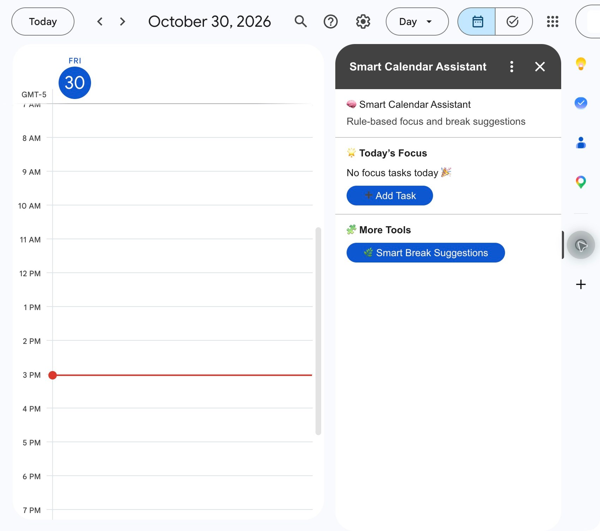
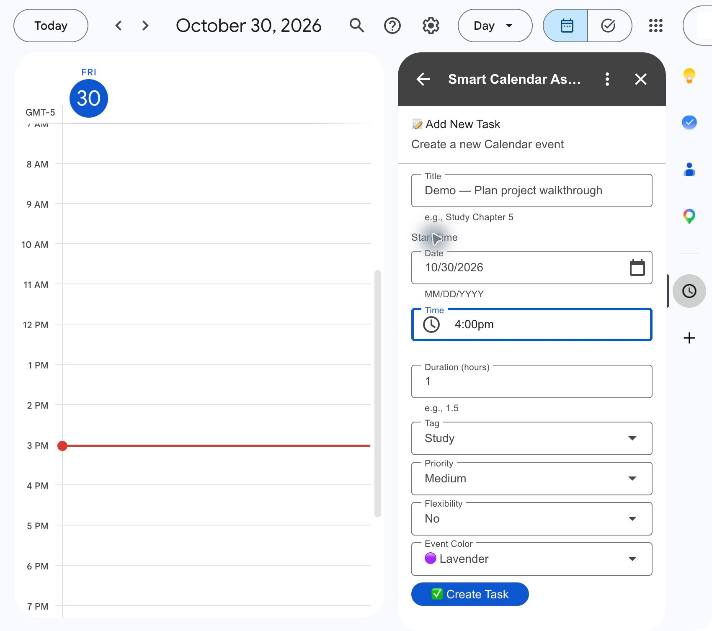
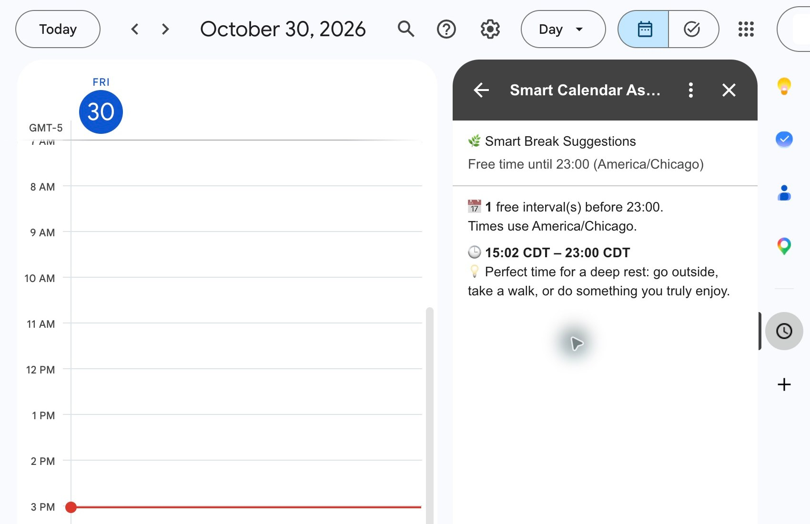

# Inside Google Calendar

[Project overview](../README.md) · [Reproducible local demo](README.md) · [Engineering validation](../ENGINEERING.md#native-google-calendar-check)

These are screenshots of the **installed Google Calendar add-on**, captured on October 30, 2026, after the maintained `Code.gs` and `smartbreaker.gs` were synchronized to the existing Apps Script project. Browser tabs and unrelated surrounding areas were cropped out; the application content was not retouched.

## 1. Native homepage

The add-on loads in Google's sidebar and describes its suggestions as **rule-based**. The selected day contains no focus tasks, so the empty state is visible.

## 2. Native task form

The form exposes title, date/time, elapsed duration, tag, priority, flexibility, and event color through native CardService controls. A fictional task title, **Demo — Plan project walkthrough**, was entered with a one-hour duration and a displayed 4:00pm time.

**The form was not submitted.** This image demonstrates the UI, not successful Calendar insertion or a verified saved-event timestamp.

## 3. Live break suggestions

Opening the break card executed the updated read-only flow against the existing calendar. With no events in the remaining window, it returned one interval from **15:02 CDT to 23:00 CDT**, labeled **America/Chicago**, with the long-gap activity suggestion.

The exact start time depends on when the card is opened. Suggestions do not schedule an event. The [local demo](README.md) provides a fixed clock and multiple synthetic events for a repeatable, populated walkthrough.

## Verification boundary

The installed homepage, task-form inputs, and live break card were checked. No real Calendar events were created or deleted, and fresh authorization, task insertion, DST cases, and picker-to-saved-event conversion were not exercised in this session. The 17 automated regression tests and synthetic demo cover application logic separately; they do not substitute for those live checks.
