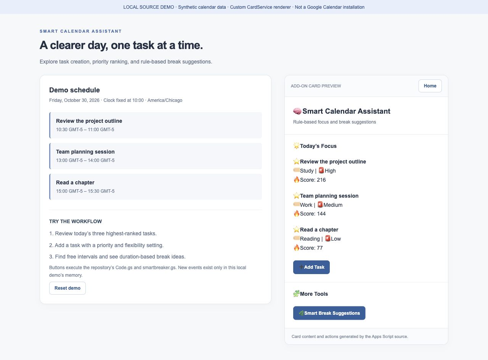
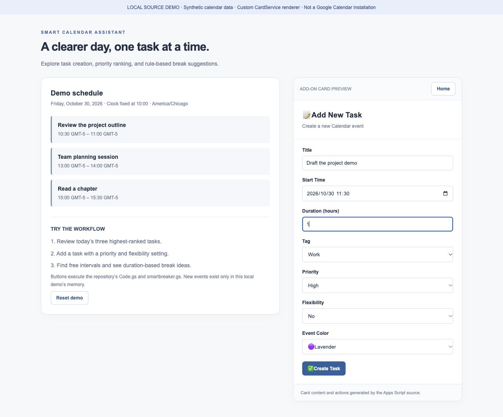
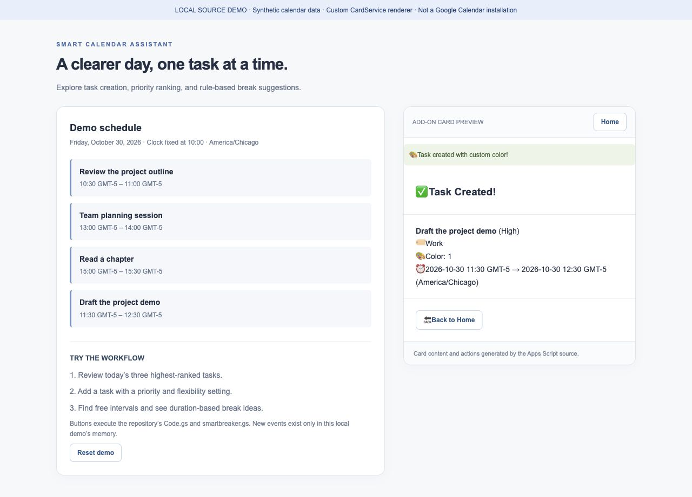
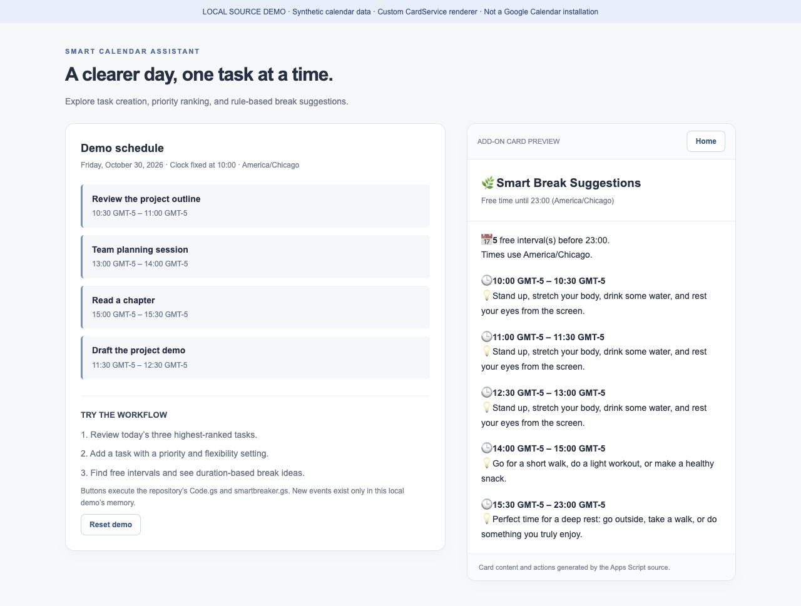

# Source-driven visual walkthrough

[Project overview](../README.md) · [Native Google Calendar screenshots](NATIVE-WALKTHROUGH.md) · [Technical details](../ENGINEERING.md)

This is a **local interactive demonstration**, captured on October 30, 2026. It executes the repository's `Code.gs` and `smartbreaker.gs` and renders their card structures through a small custom HTML adapter. It is **not an installed Google Calendar add-on** and does not reproduce Google's native CardService styling exactly. The surrounding schedule panel is demo-only.

## Run it

With Node.js 18+:

```sh
npm run demo
```

Open **http://127.0.0.1:4179**. No package installation or Google credentials are required. Stop with `Ctrl+C`.

The server binds to the local loopback interface. All events are fictional and stored only in process memory. **Reset demo** restores the three fixtures; restarting the server also resets them. The clock is fixed at **October 30, 2026, 10:00 America/Chicago**, so the screenshots are reproducible. The demo date-time input is interpreted in that same time zone; it does not emulate Google's user-time-zone picker behavior.

## 1. Review today's priorities

Three synthetic events produce focus scores of **216**, **144**, and **77**, using the source's deterministic priority function.



## 2. Create a task

Choose **Add Task** and enter:

| Field | Example |
| --- | --- |
| Title | Draft the project demo |
| Start Time | October 30, 2026, 11:30 |
| Duration | 1 hour |
| Tag | Work |
| Priority | High |
| Flexibility | No |
| Color | Lavender |



Submit **Create Task**. The actual task-building function validates the inputs and constructs a Calendar event; the mock insertion stores it locally. The confirmation shows **11:30–12:30 America/Chicago**. Returning Home places this High-priority task in the top three.



## 3. Find free intervals

Open **Smart Break Suggestions**. With the added event, the source detects five qualifying gaps: **10:00–10:30**, **11:00–11:30**, **12:30–13:00**, **14:00–15:00**, and **15:30–23:00**. Duration rules select each activity suggestion; this card does not create a break event.



## Scope

- Source-generated cards and the homepage, task-form, task-submission, and break handlers are exercised.
- Calendar reads/writes and date utilities are mocked; CardService is represented as a small builder tree.
- The renderer supports the controls used by these flows, not the full Google Workspace add-on API.
- Native Google rendering, authorization, real event writes, and deployment still require an [Apps Script test installation](../README.md#try-the-prototype).

This demo is a portfolio and local-verification aid for the team's prototype, not a Marketplace release or evidence of production adoption.
